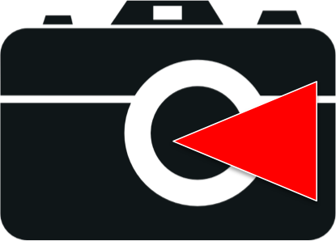

# Selfie Photographer

<br/>

A web-based installation guide for the Selfie Photographer Glassware application for Google Glass devices.

## Description

Selfie Photographer is a Google Glass application that allows users to take selfies remotely using their Android phone as a controller. This repository contains the installation website that guides users through the setup process for both the Google Glass Glassware and the companion Android application.

## Features

- **Step-by-step installation guide** for Google Glass Glassware
- **Android companion app installation** instructions
- **Responsive Bootstrap-based design** that works on all devices
- **Direct links** to Google Glass store and Google Play Store
- **Visual installation instructions** with screenshots and button examples

## Installation Process

The website guides users through a 3-step installation process:

1. **Download Selfie Photographer Glassware** - Install the Glass application from the Google Glass store
2. **Download Android Companion App** - Install the Android controller app from Google Play Store  
3. **User Feedback** - Help improve the application through feedback and usability studies

## Technology Stack

- **Frontend**: HTML5, CSS3, JavaScript
- **Framework**: Bootstrap 3.2.0
- **Libraries**: jQuery 1.11.1
- **Icons**: Custom icon set with multiple sizes (16px to 1024px)
- **Responsive Design**: Mobile-first approach with viewport optimization

## File Structure

```
├── index.html              # Main installation guide page
├── css/                    # Bootstrap CSS files
│   ├── bootstrap.min.css
│   └── bootstrap-theme.min.css
├── js/                     # JavaScript libraries
│   ├── jquery-1.11.1.min.js
│   └── bootstrap.min.js
├── icons/                  # Application icons (multiple sizes)
├── images/                 # UI images and store buttons
└── fonts/                  # Bootstrap Glyphicons
```

## Features & Functionality

- **Smart URL parameter handling**: Automatically scrolls to Android app section when redirected from Glass store
- **Visual installation cues**: Toggle button states and installation flow indicators
- **Cross-platform support**: Works on desktop, tablet, and mobile devices
- **External integrations**: Direct links to Google Glass store and Google Play Store

## Browser Compatibility

- Modern web browsers (Chrome, Firefox, Safari, Edge)
- Mobile browsers (iOS Safari, Android Chrome)
- Google Glass browser compatibility

## Links

- **Live Demo**: [http://binghuan.github.io/selfie/](http://binghuan.github.io/selfie/)
- **Google Play Store**: [Selfie Photographer Android App](https://play.google.com/store/apps/details?id=com.bh.android.selfietaker)
- **Developer Blog**: [Studio Bing-Huan](http://studiobinghuan.blogspot.tw/?view=flipcard)
- **Alternative Blog**: [BH Talk](http://bhtalk.blogspot.tw/)

## Development

This is a static website that can be deployed to any web server or GitHub Pages. The application uses:

- Bootstrap responsive grid system
- jQuery for DOM manipulation and URL parameter parsing
- Custom CSS for Glass-specific styling
- Optimized images and icons for various display densities

## Author

**Bing-Huan** - [Studio Bing-Huan](http://studiobinghuan.blogspot.tw/?view=flipcard)

## Note

*"Glass is a trademark of Google Inc."*

This project was created for Google Glass devices and requires both the Glass hardware and an Android phone for full functionality. iOS devices are not currently supported.


